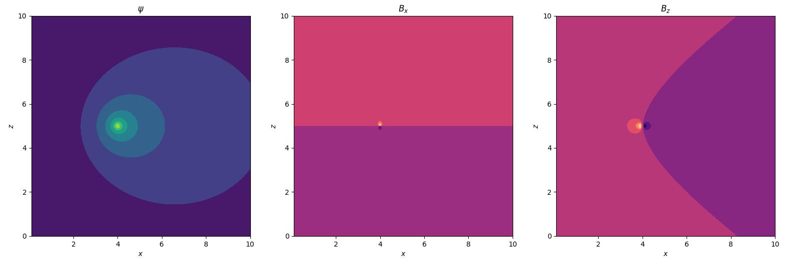
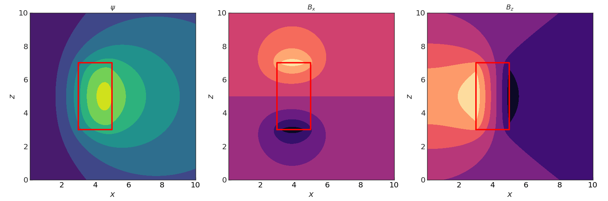
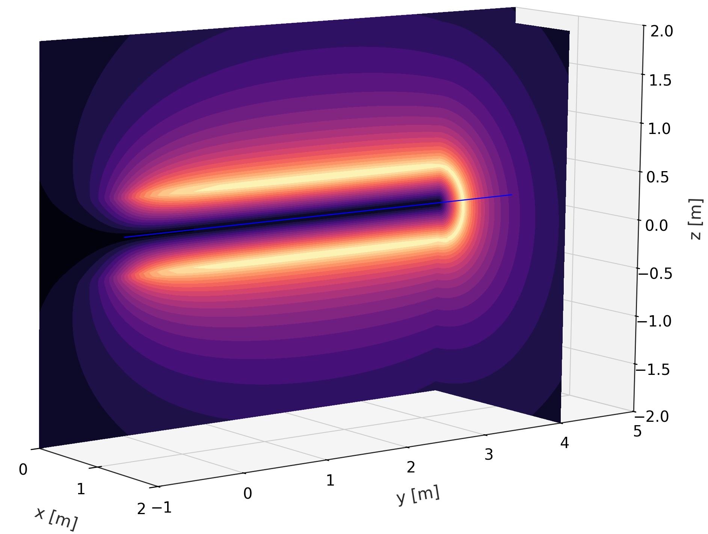
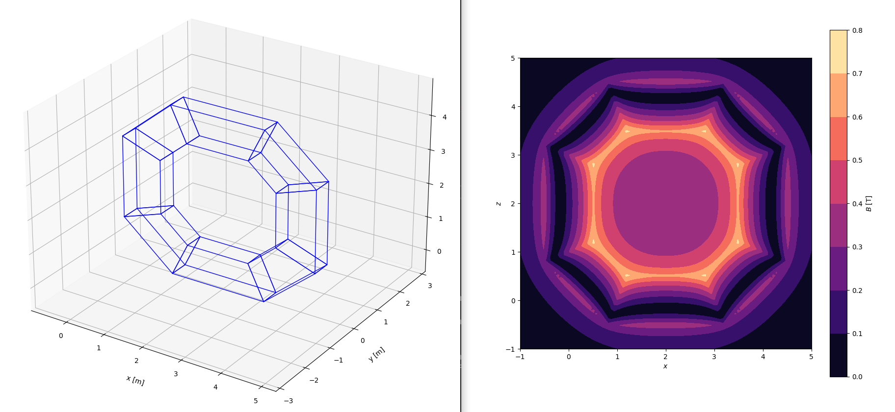
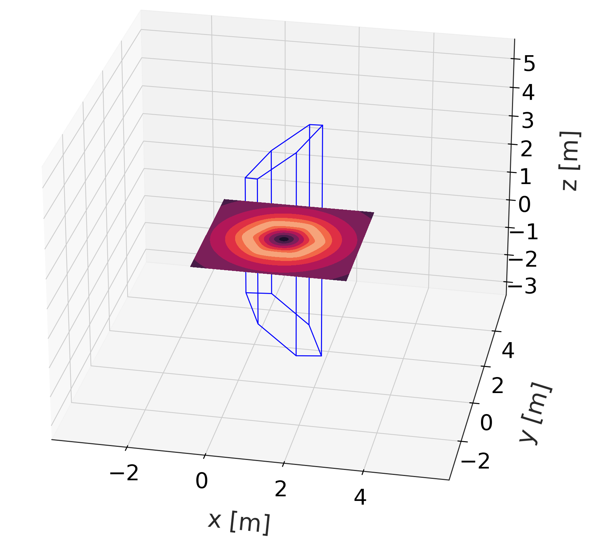
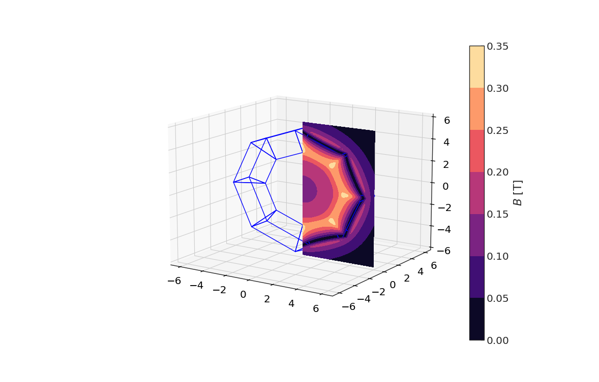
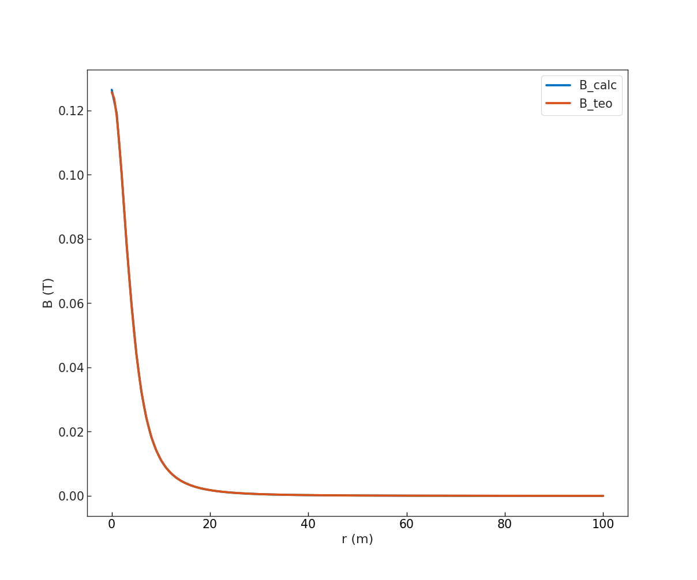

Magnetostatics
==============

A collection of analytical and semi-analytical calculation tools to evaluate magnetic
field from arbitrary coils.

2-D current sources
-------------------

The following relations are for circular current sources about the :math:`z`-axis.

Green's functions
#################

The Green’s functions for poloidal magnetic flux, radial magnetic field,
and vertical magnetic field at a point :math:`(x, z)` due to a unit
current source at point :math:`(x_c, z_c)`:

.. literalinclude:: doc_greens.py
    :language: python

To obtain the actual :math:`\psi`, :math:`B_x`, and :math:`B_z` in V.s / rad and T,
simply multiply the Green's functions by the current at the source point in Ampères.

.. Note::
    The above Green's functions are effectively for an infinitely thin filament and
    diverge logarithmically as the evaluation point approaches the source point.

.. Warning::
    The above Green's functions should only be used for :math:`x` > 0. Errors and
    garbage are to be expected for :math:`x` <= 0.

Semi-analytical functions
#########################

For a circular coil of rectangular cross-section, a semi-analytic reduction of the 3-D
Biot-Savart law is used, as developed by [Zhang_2012]_. Numerical integration is used in
one dimension, and some singularities in the equations are resolved numerically and
analytically.

.. literalinclude:: doc_semianalytic.py
    :language: python

.. Hint::
    The above semi-analytical functions are best used for points inside or near the
    current source. If you favour speed over accuracy, for points further away from the
    current source, you are better off using some quadratures of Green's functions.

3-D current sources
-------------------

Several options are available for calculating magnetic fields due to three-dimensional
current sources.

Biot-Savart
###########

The `Biot-Savart equation <https://en.wikipedia.org/wiki/Biot%E2%80%93Savart_law>`_
can be solved assuming the current sources are thin wires, as is done in the
``BiotSavartFilament`` object.

A ``radius`` argument can be specified, which makes use of a square decay law for values
inside the filament ``radius``. The field from a filament thus reaches a maximum at the
surface of the filament.

.. literalinclude:: doc_biotsavart.py
    :language: python

.. Note::
    The discretisation of geometry input should be carefully checked. In general, many
    points will give better approximations to long, thin wires.

Semi-analytical
###############

If the infinitely thin approximation is not appropriate for your use case, consider
using one of the ``RectangularCrossSectionCurrentSource`` objects.

Trapezoidal prisms
******************

A ``TrapezoidalPrismCurrentSource`` object is used for straight bars of uniform
current density, with taperings at either end. The magnetic field can be calculated at
any point, following equations described in [Babic_2005a]_ and [Babic_2005b]_.

.. literalinclude:: doc_trapezoidal.py
    :language: python

.. figure:: pic_trapezoidal.png
    :name: fig:trapezoidal

The tapering at either end of the current source is to facilitate treatment of
curvilinear circuits. As the tapering is only in one plane however, this treatment
is only directly applicable to planar curvilinear circuits.

The ``ArbitraryPlanarRectangularXSCircuit`` is a utility provided to enable the user to
easily set up a planar circuit with a rectangular cross-section using
``TrapezoidalPrismCurrentSource`` objects.

.. literalinclude:: doc_planar.py
    :language: python

Circular arcs
*************

A ``CircularArcCurrentSource`` object is used for circular arcs of rectangular
cross-section and uniform current density. The magnetic field and vector potential can
be calculated at any point. The integrals over the cross-section are done analytically,
following [Urankar_1982]_ (eqs. 3 and 4), leaving one integral over angle which is
evaluated by adaptive quadrature.

In the local cylindrical frame of the arc, the conductor occupies
:math:`r_1 = r - b \le r' \le r_2 = r + b`, :math:`|z'| \le d` and
:math:`0 \le \phi' \le \theta`, and carries a uniform current density :math:`J`
along :math:`\hat{e}_{\phi'}`. For a point at :math:`(r_{pc}, \phi_{pc}, z_p)`, let
:math:`\psi = \phi' - \phi_{pc}` and define

.. math::
    c = r_{pc}\cos\psi, \quad s = r_{pc}\sin\psi, \quad u_j = r_j - c,
    \quad Z_k = z_p \pm d, \quad D = \sqrt{u_j^2 + s^2 + Z_k^2}

With the cross-section kernel

.. math::
    G(\psi) = \iint \frac{r'}{R}~dr'dz'
    = -\sum_{j=1}^{2}\sum_{k=1}^{2}(-1)^{j+k} F(r_j, Z_k)

    F = \frac{Z_k D}{2} + \frac{r_j^2 - c^2 + s^2}{2}\sinh^{-1}\frac{Z_k}{\sqrt{u^2+s^2}}
    + c Z_k\sinh^{-1}\frac{u}{\sqrt{s^2+Z_k^2}} - c s\tan^{-1}\frac{u Z_k}{s D}

the vector potential is

.. math::
    A_r = -\frac{\mu_0 J}{4\pi}\int_{-\phi_{pc}}^{\theta-\phi_{pc}}\sin\psi~G~d\psi,
    \quad
    A_t = \frac{\mu_0 J}{4\pi}\int_{-\phi_{pc}}^{\theta-\phi_{pc}}\cos\psi~G~d\psi,
    \quad A_z = 0

The field is obtained from derivatives of the same kernel, rather than from a
separate Biot-Savart kernel. Since :math:`A_z = 0` and :math:`G` depends on
:math:`z_p` only through :math:`Z_k`:

.. math::
    B_r = -\frac{\partial A_t}{\partial z_p}
    = -\frac{\mu_0 J}{4\pi}\int\cos\psi~\frac{\partial G}{\partial z_p}~d\psi,
    \quad
    B_t = \frac{\partial A_r}{\partial z_p}
    = -\frac{\mu_0 J}{4\pi}\int\sin\psi~\frac{\partial G}{\partial z_p}~d\psi

    B_z = \frac{\mu_0 J}{4\pi}\int\left.\frac{\partial G}{\partial c}\right|_{s, Z}d\psi

The axial field does not follow as simply from :math:`\nabla\times\mathbf{A}`.
Instead, from the Biot-Savart law,
:math:`(\hat{e}_{\phi'}\times\mathbf{R})_z = -\hat{e}_{r'}\cdot\mathbf{R} = r' - c`,
and since :math:`R^2 = (r' - c)^2 + s^2 + Z^2`,
:math:`\partial_c (r'/R) = r'(r' - c)/R^3` is exactly the :math:`B_z` integrand.
The derivatives are taken corner by corner, with the corner primitives

.. math::
    \frac{\partial F}{\partial Z} = D + c\sinh^{-1}\frac{u}{\sqrt{s^2+Z_k^2}}

    \frac{\partial F}{\partial c} = -c\sinh^{-1}\frac{Z_k}{\sqrt{u^2+s^2}}
    + Z_k\sinh^{-1}\frac{u}{\sqrt{s^2+Z_k^2}} - s\tan^{-1}\frac{u Z_k}{s D}

The (radial, tangential) components are rotated to local Cartesian components at
:math:`\phi_{pc}`, and then to the global frame. For a full circle, :math:`A_r` and
:math:`B_t` vanish by symmetry.

The remaining integrands have integrable logarithmic singularities at
:math:`\psi = 0` when the point lies on a face of the conductor. These are resolved by
the adaptive quadrature, with breakpoints placed from the geometry.

.. literalinclude:: doc_circular.py
    :language: python

.. figure:: pic_circular.png
    :name: fig:circular

Volume integral method
----------------------

The magnetic field due to a uniform current density distribution :math:`\mathbf{J}` in
a volume :math:`V` can be written as:

.. math::
    :label: B_J_rr3_dV

    \mathbf{B} = \dfrac{\mu_0}{4\pi}\mathbf{J}\times\int_{V} \dfrac{\mathbf{r}-\mathbf{r^{'}}}{\lvert \mathbf{r}-\mathbf{r^{'}}\rvert^{3}}d^{3}r^{'}

Following a procedure described in [Fabbri_2008]_, this volume integral can be solved by
a series of surface integrals, which themselves can be solved as a series of line integrals.

A ``PolyhedralPrismCurrentSource`` object is used to describe a conductor segment of
uniform current density, with an arbitary (polygonal) cross-section.

.. literalinclude:: doc_polyhedral.py
    :language: python

Tapering at the ends of the current source allows for the facilitation of circuits,
like with the trapezoidal current source. The
``ArbitraryPlanarPolyhedralXSCircuit`` is a utility provided to enable the construction
of planar circuits, making use of the ``PolyhedralPrismCurrentSource`` object.

.. Note::
    Sadly, the ``PolyhedralPrismCurrentSource`` can only handle equal angle end-caps.
    This is due to a limitation of the formulation that will hopefully be resolved in
    future.

.. literalinclude:: doc_polyhedral_planar.py
    :language: python

Finite element
--------------

The implementation of the magnetostatic Finite Element solver is limited to
2D axially symmetric problems.
In such an approximation, the Maxwell equations, as function of the poloidal
magnetic flux (:math:`\Psi`), are reduced to the form ([Zohm_2015]_, page 25):

.. math::
    :label: strong_form

    r^2 \nabla\cdot\left(\frac{\nabla\Psi}{r^2}\right) = 2
    \pi r \mu_0 J_{\Phi}

whose weak formulation, considering null Dirichlet boundary conditions,
is defined as ([Villone_2013]_):

.. math::
    :label: weak_form

    \int_{D_p} {\frac{1}{r}}{\nabla}{\Psi}{\cdot}{\nabla} v \,dr\,dz = 2
    \pi \mu_0 \int_{D_p} J_{\Phi} v \,dr\,dz

where :math:`v` is the basis element function of the defined functional subspace
:math:`V`.

.. literalinclude:: doc_fem_single_coil.py
    :language: python

.. rubric:: References

.. [Zhang_2012] D. Zhang, C. S. Koh, An Efficient Semianalytic Computation Method of Magnetic Field for a Circular Coil With Rectangular Cross Section, IEEE Transactions on Magnetics, 2012, pp. 62-68 :doi:`10.1109/TMAG.2011.2167981`
.. [Babic_2005a] S. Babic and C. Aykel, An improvement in the calculation of the magnetic field for an arbitrary geometry coil with rectangular cross section, International Journal of Numerical Modelling, Electronic Networks, Devices and Fields, 2005, vol. 18, pp. 493-504 :doi:`10.1002/jnm.594`
.. [Babic_2005b] S. Babic and C. Aykel, An improvement in the calculation of the magnetic field for an arbitrary geometry coil with rectangular cross section - Erratum, International Journal of Numerical Modelling, Electronic Networks, Devices and Fields, 2005
.. [Urankar_1982] L. K. Urankar, Vector potential and magnetic field of current-carrying finite arc segment in analytical form, Part III: Exact computation for rectangular cross section, IEEE Transactions on Magnetics, 1982, vol. 18, no. 6, pp. 1860-1867 :doi:`10.1109/TMAG.1982.1062166`
.. [Fabbri_2008] M. Fabbri, Magnetic Flux Density and Vector Potential of Uniform Polyhedral Sources, IEEE Transactions on Magnetics, 2008, vol. 44, no. 1 :doi:`10.1109/TMAG.2007.908698`
.. [Zohm_2015] H. Zohm, Magnetohydrodynamic Stability of Tokamaks, Wiley-VCH, Germany, 2015 :doi:`10.1002/9783527677375`
.. [Villone_2013] VILLONE, F. et al. Plasma Phys. Control. Fusion 55 (2013) 095008, :doi:`10.1088/0741-3335/55/9/095008`
